# Naira Desk: Architecture

*Version 0.1, 13 Oct 2026. Hackathon: Agents on Open Rails (Celo). Tracks: **Textile FX** (main) and **Build with buy** (add-on). Attribution code: `celo_1944046be211`.*

**Legend:** ✅ verified (onchain, source code or docs, 13 Oct) · ⚠️ assumption to confirm · ❓ open question that blocks something.

---

## 0. In one paragraph

Naira Desk is an **autonomous, community-funded naira market maker** on Celo. We deploy a Textile **Operator Vault** for cNGN/USD₮ on Celo. Community LPs deposit small amounts. Our agent prices the naira from several independent sources, reads the news through paid **buy** calls, and decides when to quote, when to be careful and when to stop. Textile's Stitch bot signs quotes with the agent's key, and Textile's Warp service co-signs them. Takers on Textile trade against the vault. The vault contract makes it impossible for us to withdraw LP funds. Everything (fills, NAV per share, P&L, paid calls, tags) is shown on a public **/proof** page that judges can verify onchain.

**Goals**
1. Positive, verifiable strategy P&L and real volume on Textile (Celo).
2. Community-funded: liquidity comes from LP deposits into the vault. Running costs are gas plus about $5 of buy calls.
3. Runs unattended 1–9 Nov, fails safe, with a phone kill switch.
4. Every transaction we send is tagged. The ERC-8004 identity is live and links the agent, vault and repo.

**Non-goals (for this hackathon):** other corridors (wARS/wBRL come later), our own RFQ maker protocol, a custom smart contract, a MiniPay mini-app listing, fiat ramps.

---

## 1. What the deep review found, and what it changed

| # | Finding | Status | Design consequence |
|---|---|---|---|
| 1 | `OperatorVaultFactory.deployVault` only checks `msg.sender == init.operatorAdmin`. Deposits have no allowlist. | ✅ factory and vault source, Blockscout-verified | We can deploy our own vault, and community LPs can fund it directly. |
| 2 | Every vault fill needs **two EOA signatures** (strategy and risk) over the Permit2 digest, plus order-policy checks: reactor, swapper = vault, trading epoch in the nonce, lifetime cap, per-order caps, quotable inventory, close-only, preferred fillers. | ✅ `VaultPolicy.validateEnvelope` | The contract enforces safety, not our code. |
| 3 | Stitch docs: the **venue supplies "Warp" co-signing**, and "the dealer must obtain the independent risk signature through its authorized Warp integration." Both existing Celo vaults use the same `riskSigner` `0x9bC2…32a3` and `riskAdmin` `0x5172…bA4`. | ✅ docs, onchain, and confirmed by Textile's CTO (13 Oct) | **Risk signer = Textile Warp, not our own agent.** Our risk logic moves *before* signing (pricer, risk officer) and *after* (guardian). Textile confirmed Warp co-signs fills for our vault. |
| 4 | Stitch already has **vault modules**: inventory balancing, dynamic spreads, spot rebalancing. It also co-signs NAV attestations. | ✅ `docs/modules.md` | We **don't rebuild** quoting maths. Our agent adds what Stitch lacks: multi-source naira pricing, news regime, guardian, keeper, buy, proof. |
| 5 | Stitch prices off an HTTP feed `{price, timestamp}`, where price is *stable per soft* (USD₮ per cNGN). Stale or invalid prices stop quoting. | ✅ README and ADVANCED.md | The **feed is our control surface**: price in, and a halt is a 503 response. |
| 6 | The vault pre-approves Permit2 in its constructor. | ✅ `OperatorVault` constructor | No approval transactions are needed for trading. |
| 7 | Onchain, a fill is `Fill(orderHash, filler = taker, swapper = maker)`. | ✅ decoded reactor logs | The maker in a fill = **our vault address**. Indexing is simple. |
| 8 | Celo Textile, last 24h: **136 fills, 13 distinct takers, 5 makers. One maker did about 75%.** | ✅ RPC log scan | Real flow, but concentrated. A small vault wins a share, not all of it. |
| 9 | Uniswap V3 on Celo has a **cNGN/USD₮ pool** (0.01% fee, `0x6519…7d32`, about $96k USD₮ + ₦116M ≈ $180k), and also wARS and wBRL pools. | ✅ factory `getPool` and balances | Free onchain reference price and an **arbitrage guard**: never quote outside a band around Uniswap. |
| 10 | Existing vault settings: 15-minute deposit and redeem epochs, 1-day valuation timeout, 2-day emergency exit, 2-hour order lifetime, 10% performance fee, Textile's protocol share = 10% of performance. | ✅ `cast call` and `ProtocolTermsSet` | We copy these known-good settings (section 7). |
| 11 | Textile Ramp (NGN bank) is BSC/Base only. | ✅ live API | No fiat in v1. LPs deposit USD₮ or cNGN that is already on Celo. |

---

## 2. System context

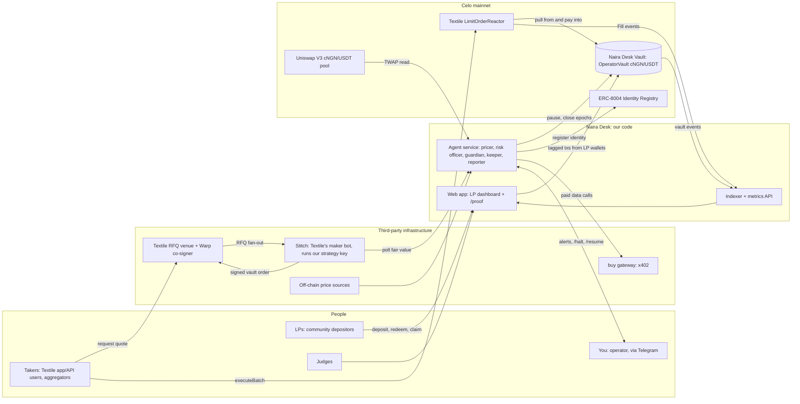

---

## 3. Actors, agents and keys

### 3.1 The agents (logical roles inside one service, plus Stitch)

| Agent | Runs where | Decides | Can never |
|---|---|---|---|
| **Pricer** | our agent service | Fair value of cNGN in USD₮ from 3+ sources. Whether the price is trustworthy enough to quote. | Sign anything. Move funds. |
| **Risk officer** | our agent service | Regime (Normal, Caution, Halted) from news (bought via buy), volatility, source divergence. Which data is worth buying. | Narrow spreads below the floor. Exceed the buy budget. |
| **Executor** | **Stitch** (Textile code, our strategy key) | Quote size and side within vault caps, inventory balancing, dynamic spread. | Sign without our feed being fresh. Get a fill without Warp's co-sign. |
| **Guardian** | our agent service (guardian key) | When to **pause the vault onchain**. | Move LP funds. The contract only lets the guardian pause, unpause and sweep *unrelated* tokens. |
| **Keeper** | our agent service | Watching epochs (Stitch and Textile run them), alerting you if one is stuck, fallback `closeDepositEpoch`. | Set NAV (Stitch and Warp do it). |
| **Reporter** | our agent service | What to publish: metrics, daily report, alerts. | Change trading. |

### 3.2 Keys and vault roles

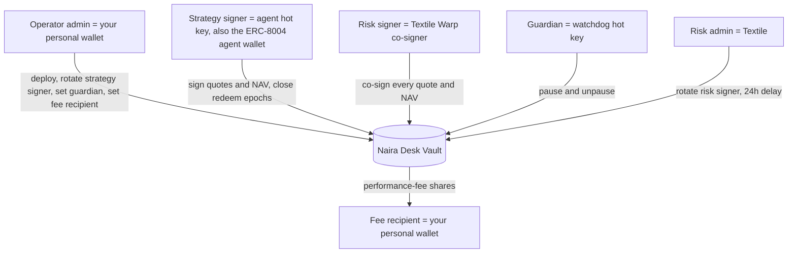

Contract rules: `strategySigner ≠ riskSigner` and `operatorAdmin ≠ riskAdmin` ✅.

**Why the guardian is a separate hot key:** it can pause the vault automatically while you travel. If it leaks, the worst an attacker can do is pause or unpause. The operator admin (you) can replace it with `setGuardian`.

---

## 4. Components

| Component | Stack | Responsibility |
|---|---|---|
| `apps/agent` | Node 22, TypeScript, viem, Hono | Pricer, risk officer, guardian, keeper, reporter. Serves `/feed/cngn-usdt` to Stitch and `/api/*` read-only metrics. Telegram ops bot. |
| `apps/indexer` | TypeScript, viem `getLogs`, SQLite | Reactor `Fill` (swapper = vault), vault events (`DepositRequest`, `RedeemRequest`, `EpochClosed`, `DepositEpochProcessed`, `RedeemEpochSettled`, `Claimed`, `NavSettled`, `FeeAccrued`, `Paused`), our agent transactions, counterparty independence checks. |
| `apps/web` | Next.js, wagmi/viem, Recharts | **LP app** (deposit, claim, redeem, risk card, position) and **/proof** (judge page). Every write is tagged. |
| `packages/chain` | viem, `@celo/attribution-tags` | The **only** place wallet clients are created (`withAttribution`). ABIs: vault, factory, reactor, ERC-8004, ERC-20, Uniswap pool. |
| `packages/pricing` | pure TypeScript | Source adapters plus fair-value maths (unit-tested, no I/O in the core). |
| `infra/stitch` | Docker, pinned Stitch release | `stitch.toml`: vault mode, modules, feed URL to our agent. Profiles: `normal.toml` and `caution.toml`. |
| `scripts/` | tsx | `register-8004`, `deploy-vault`, `verify-tags`, `independence-check`, `export-proof`. |

---

## 5. Deployment topology

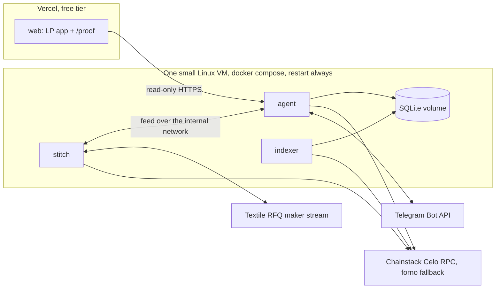

⚠️ **Hosting without a card.** Options:
- A crypto-paid VPS (about $5/month).
- A free tier that doesn't sleep (to verify).
- Asking Chainstack or sponsors for a VM.

Stitch is a small Rust binary, so 1 vCPU and 1 GB RAM is enough.

---

## 6. Onchain layer

### 6.1 Addresses (Celo 42220)

| Contract | Address | Status |
|---|---|---|
| OperatorVaultFactory | `0x88104decA449C797632AfdcA77A3140b24cD844A` | ✅ |
| LimitOrderReactor | `0xa9AA0a64769cBed4d3B1Ceb4Df01CdE915C235b3` | ✅ |
| Permit2 | `0x000000000022D473030F116dDEE9F6B43aC78BA3` | ✅ |
| Fee controller (1 bp) | `0x7b005466F905DD882A959888154587fA76cd3Ea7` | ✅ |
| cNGN (6 decimals) | `0xF6829D7393dAe24509eb1E52eE8e572e2E271a4f` | ✅ |
| USD₮ (6 decimals) | `0x48065fbBE25f71C9282ddf5e1cD6D6A887483D5e` | ✅ |
| ERC-8004 Identity / Reputation | `0x8004A169…a432` / `0x8004BAa1…9b63` | ✅ |
| Uniswap V3 cNGN/USD₮ 0.01% | `0x6519d56Eb0A69FC0338657784c783B169b8f7d32` | ✅ |
| Textile Warp risk signer (used by existing vaults) | `0x9bC2f7601f22fFA95bD9dDbF9Bc11d06f54B32a3` | ✅ Warp co-signs our vault. Take the exact value from the deploy-page preset. |
| Textile risk admin (used by existing vaults) | `0x51727A09b55d56BF8f3CBe61f460327330aECbA4` | ✅ take the exact value from the deploy-page preset |

### 6.2 Proposed vault parameters (`VaultInit`)

**Textile's guidance (13 Oct):** copy the presets from `app.textilecredit.com/s/vaults/deploy` (risk signer, fee collector, Textile fee shares, and so on), and set the **operator (strategy) signer to the Stitch wallet**. Deploying from our own script is fine if most values stay the same. The values below are our starting point; **the deploy-page presets win wherever they differ.**

| Field | Value | Why |
|---|---|---|
| name / symbol | `Naira Desk cNGN/USDT Vault` / `ndUSDT-cNGN` | Within the 64- and 16-byte limits ✅ |
| settlementAsset / corridorAsset | USD₮ / cNGN | The corridor with the most Celo flow |
| operatorAdmin / feeRecipient | your wallet | You control admin; fees go to you |
| strategySigner | agent key **A** | Also the ERC-8004 agent wallet |
| riskSigner / riskAdmin | Textile Warp / Textile | ✅ deploy-page preset |
| guardian | watchdog key **G** | Automatic pause |
| maxOrderInputSettlement | 250 USD₮ (`250e6`) | Small blast radius while new; raise later |
| maxOrderInputCorridor | ₦350,000 (`350000e6`) | About the same in USD |
| minReserveSettlement / Corridor | 0 / 0 | Keep simple |
| maxOrderLifetime | 7200 s | Same as existing vaults |
| deposit / redemption epoch | 900 s / 900 s | Same as existing |
| redemptionCloseCooldown | 86,400 s | Same as existing (⚠️ consider 3,600 for friendlier LP exits) |
| valuationTimeout / emergencyExitTimeout | 86,400 / 172,800 s | Must satisfy emergency > valuation ✅ |
| managementFeeWad / performanceFeeWad | 0 / 0.10e18 | LP-friendly. You earn only if LPs earn. |
| protocolManagementShareWad / PerformanceShareWad | 0 / 0.10e18 | Matches the existing vault. Use the deploy-page preset. |
| riskSignerDelay | 86,400 s | Same as existing |
| minDepositAssets | 2 USD₮ (`2e6`) | Small community tickets |
| minDepositCorridor | ₦3,000 (`3000e6`) | Lets cNGN holders deposit cNGN |
| minRedeemShares | 1 share (`1e6`) | Smaller amounts allowed when redeeming a whole balance ✅ |
| enableYield / minLiquidSettlement | false / 0 | No yield adapter in v1 |
| perfFloorEnabled | true | High-water mark: no fee until a new all-time-high price per share |

---

## 7. Core flows

### 7.1 Bootstrap (one-time, before 19 Oct)

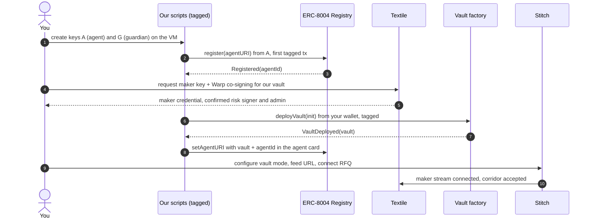

### 7.2 Core loop: RFQ quote to fill

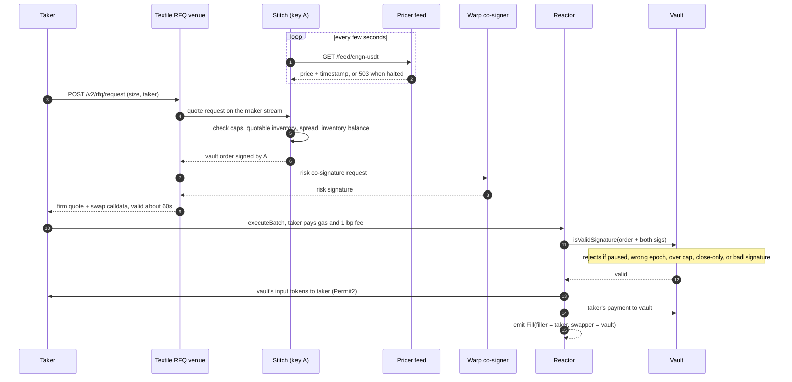

⚠️ How the venue gets Warp's signature is inferred from the Stitch docs ("the existing venue supplies Warp co-signing"). Confirm with Textile.

### 7.3 LP deposit

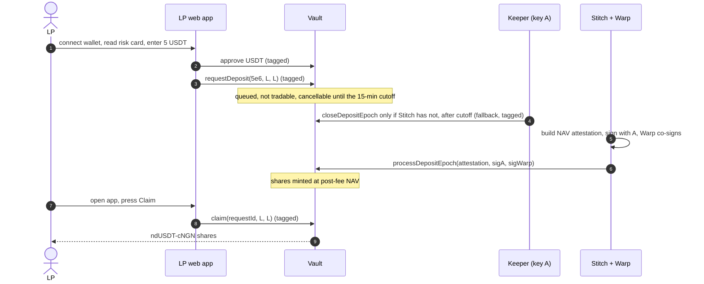

✅ Textile (13 Oct): **Stitch and Textile handle epochs and NAV attestations.** Our keeper only watches them, alerts you if one is stuck, and can send the permissionless `closeDepositEpoch` as a fallback.

### 7.4 LP redemption

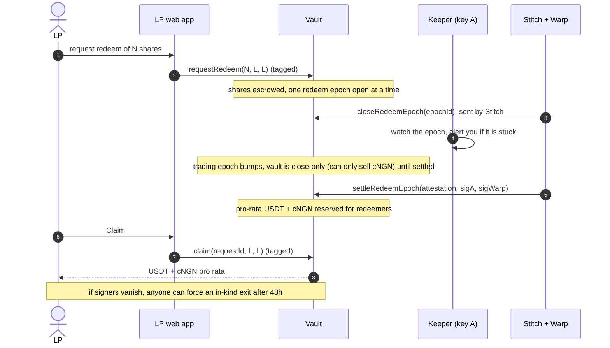

**UX note:** redeemers receive **both** assets pro rata. The app must say this before they deposit, and offer an optional "swap my cNGN to USD₮" link that routes to *other* makers.

### 7.5 Pricing pipeline (Pricer)

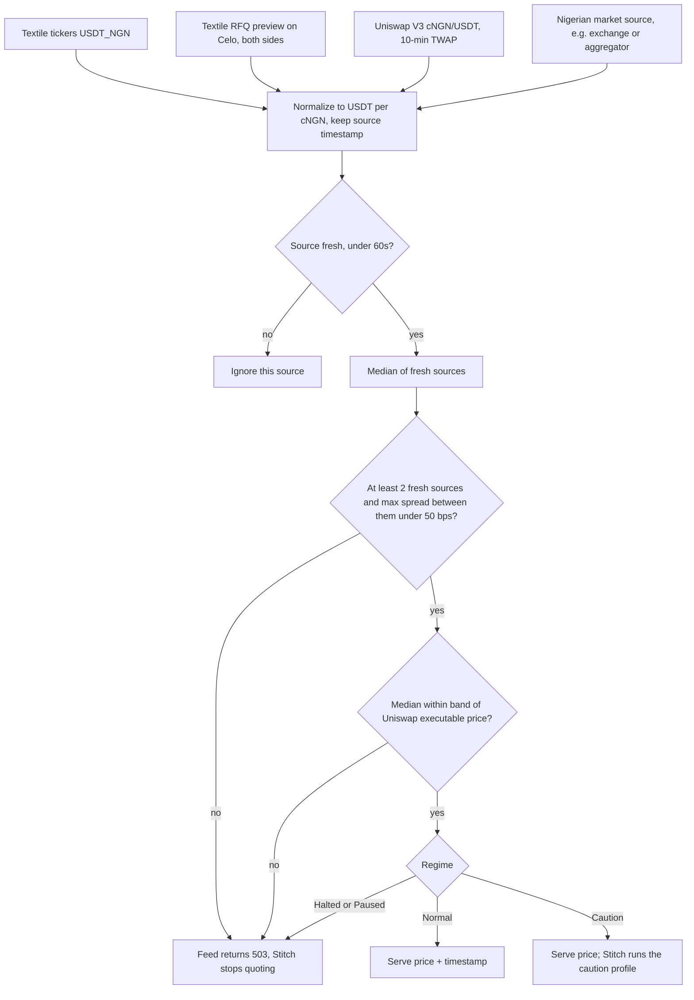

Inventory balancing and dynamic spread happen **inside Stitch** (modules), so we don't skew twice. The feed stays a clean fair value.

**Why the Uniswap band matters:** if our quote drifts away from the Uniswap pool price, arbitrageurs will hit it immediately and LPs lose. The band is the anti-arbitrage guard. Thresholds (60s, 50 bps, band width) are starting values to tune on 17–19 Oct.

### 7.6 Risk regime (Risk officer + Guardian)

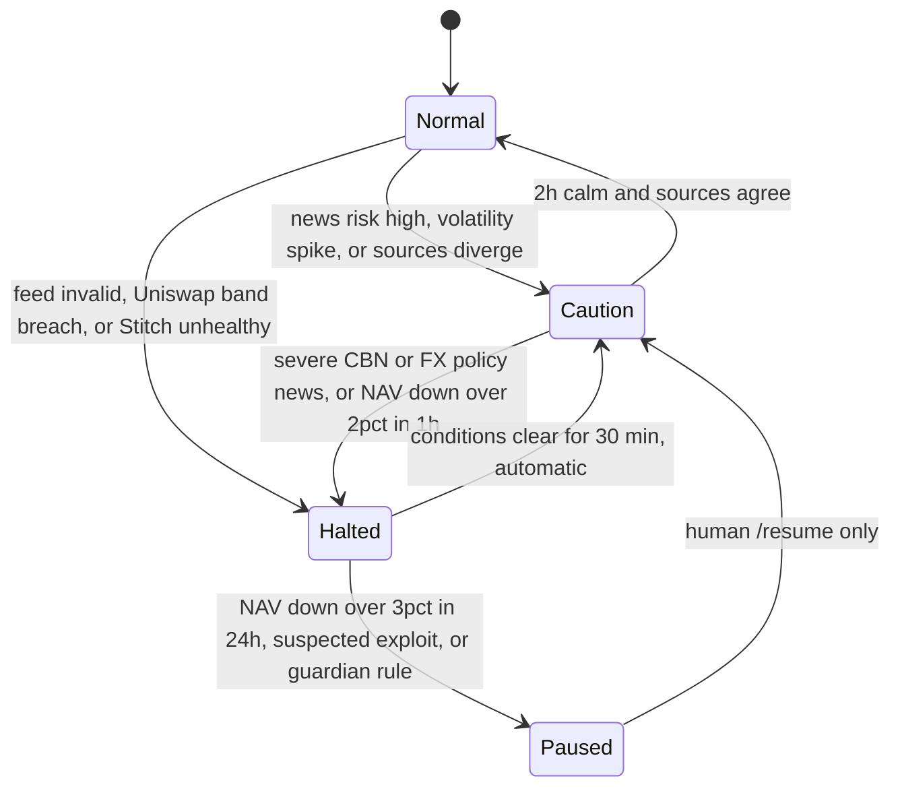

| Regime | Feed | Stitch | Onchain |
|---|---|---|---|
| Normal | live | `normal.toml` | — |
| Caution | live | `caution.toml`: wider spread, half size (restart, at most a few per day) | — |
| Halted | 503 | stops quoting (stale feed) | — |
| Paused | 503 | stopped | `guardian.pause()`: invalidates all outstanding orders ✅ |

The rule while you travel: the agent may **stop itself** automatically, but **only you** can resume after an onchain pause.

### 7.7 Intel loop with buy (Risk officer)

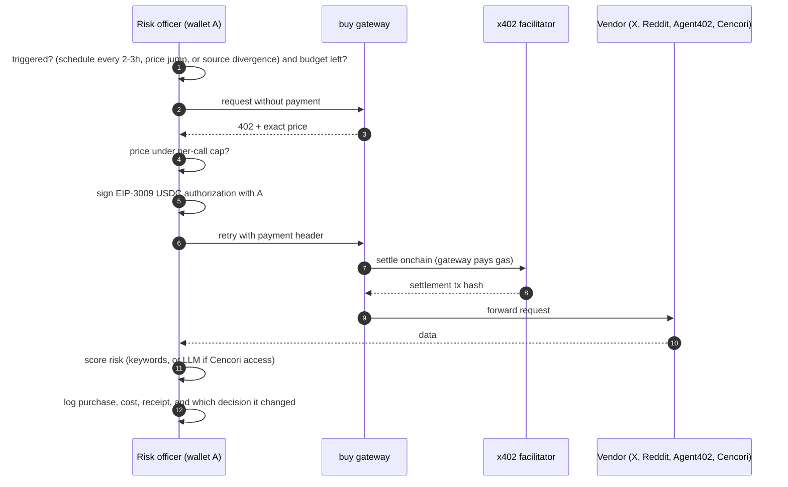

| Purchase | Vendor | Price (catalog, 9 Oct) | Trigger |
|---|---|---|---|
| X search: "CBN", "naira", "dollar rate", "FX" | X Data | $0.005 | every 2–3h, plus on price jumps |
| Reddit search | Reddit Data | $0.005 | every 6h |
| Address screening of each **new depositor** | Agent402 | $0.002 | once per new LP address |
| Backup RPC batch | Chainstack | $0.01 per ≤2,000 calls | only when primary RPC fails |
| LLM risk classification | Cencori | $0.01 | ❓ closed beta; otherwise keyword rules |

Budget: **$0.20/day hard cap, $5 total**, enforced in code. ⚠️ We pay with our own x402 client using key A, so the payer is the registered agent wallet. If the gateway needs the `@celo/buy` client, check whether it can use key A.

### 7.8 Guardian (watchdog) rules

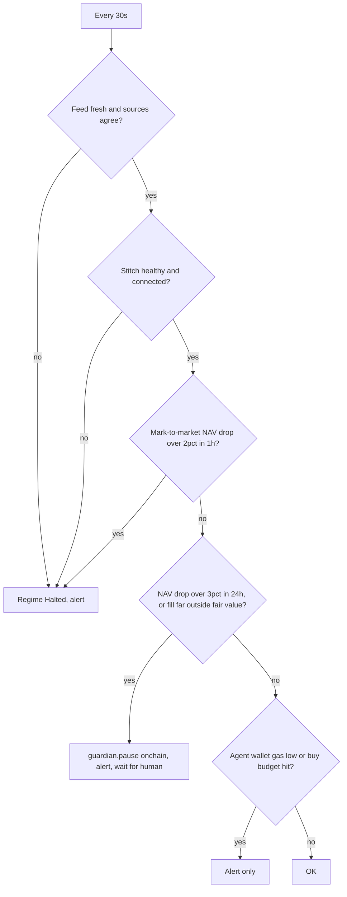

### 7.9 Metrics and proof pipeline

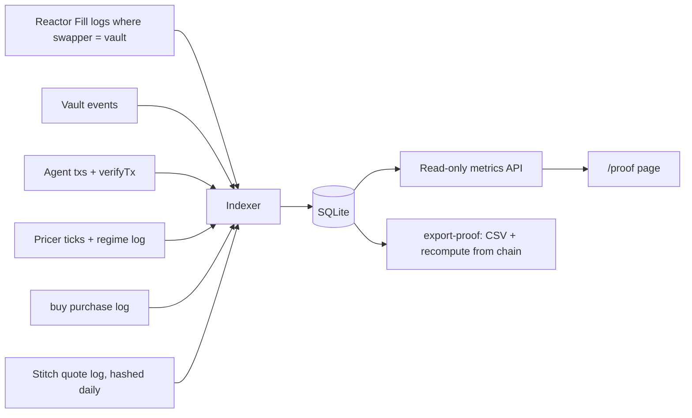

---

## 8. User journeys

### 8.1 LP (example persona: Ada in Lagos, 20 USD₮ on Celo)

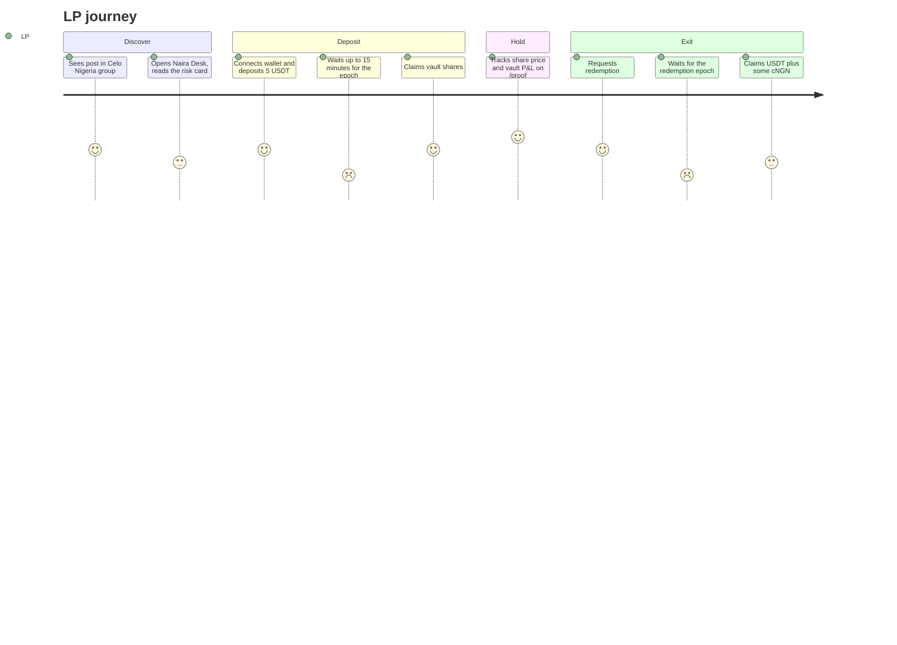

**Risk card (shown before any deposit):**
- You can lose money if the naira moves against the vault.
- You get both USD₮ and cNGN back.
- Exits take one epoch.
- The operator **cannot** withdraw your funds; the contract enforces it.
- This is an experiment with caps; deposit only what you can afford to lose.

### 8.2 Taker

Nothing new for them. They use the Textile app or API as usual, and our vault is one of the makers that may quote. A **preferred-liquidity deep link** (`preferredLiquidityWallets` = our Stitch maker address ⚠️ for vault mode) lets community members ask our vault first, with the rate shown before they commit.

### 8.3 You (operator)

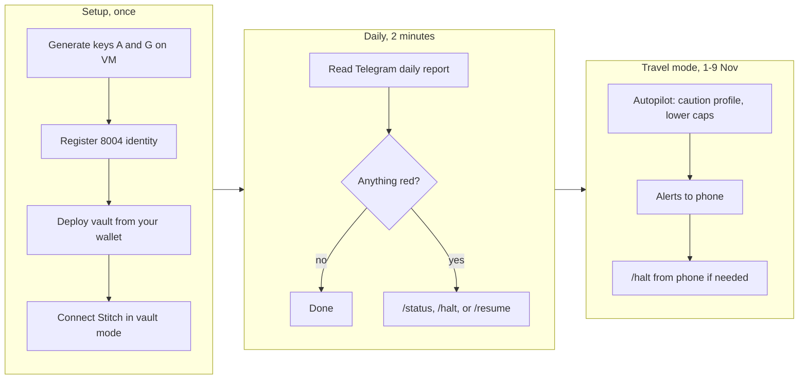

### 8.4 Judge

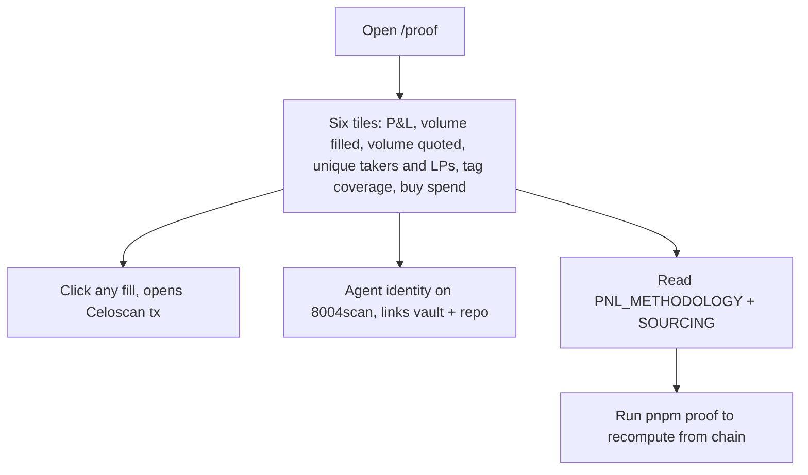

---

## 9. Attribution and ERC-8004 wiring

| Transaction | Sent by | Tagged? | How |
|---|---|---|---|
| `register`, `setAgentURI` (ERC-8004) | agent A | ✅ | viem `withAttribution(["celo_1944046be211"])` in `packages/chain` |
| `deployVault` | your wallet via our script | ✅ | same client wrapper |
| `closeDepositEpoch` fallback (only if stuck) | keeper (A) | ✅ | same |
| `pause`, `unpause` | guardian G | ✅ | same |
| LP `approve`, `requestDeposit`, `requestRedeem`, `claim` | **LP wallets (independent)** | ✅ | wagmi `dataSuffix` in `apps/web` |
| ERC-8004 `giveFeedback` from LPs (stretch) | LP wallets | ✅ | same |
| RFQ fill `executeBatch` | taker | ❌ not ours | Maker is visible as `Fill.swapper = vault` ✅ |
| epoch closes, `processDepositEpoch`, `settleRedeemEpoch` | Stitch / Textile ✅ | ❌ not ours | Textile confirmed they handle epochs and NAV |
| buy x402 settlements | facilitator | ❌ (facilitator doesn't tag yet) | Payer = A |

**Agent card** (`/.well-known/agent-registration.json`):
- `services`: `web` (/proof), `vault` (`eip155:42220:<vault>`), `wallet` (`eip155:42220:<A>`), `repo`.
- `supportedTrust: ["reputation"]`.
- `registrations` added after registering.

The card links agent, vault and repo so the judges' query can connect vault fills to our entry. ✅ Textile confirmed (13 Oct) that fills where our vault is the maker count as our volume and P&L.

---

## 10. Data model (SQLite)

| Table | Key fields |
|---|---|
| `price_ticks` | source, price_usdt_per_cngn, source_ts, received_ts |
| `fair_value` | ts, median, sources_used, max_divergence_bps, uni_band_ok, regime |
| `regime_log` | ts, from, to, reason, triggered_by (rule, purchase id) |
| `fills` | tx, block, ts, order_hash, taker, side, usdt_amount, cngn_amount, price, fair_at_fill, edge_bps |
| `vault_snapshots` | ts, free_settlement, free_corridor, total_supply, nav_at_fair, pps |
| `lp_events` | tx, ts, type, lp, epoch_id, amount, shares, asset |
| `purchases` | ts, vendor, endpoint, cost_usd, settlement_tx, summary, decision_changed |
| `agent_txs` | hash, kind, sender, tag_verified |
| `counterparties` | address, role (taker/lp), first_seen, first_funder, active_before_6_oct, label (independent/unknown/mine) |
| `quotes` | ts, side, size, price, won (from Stitch logs; self-reported) |

**P&L (published in PNL_METHODOLOGY.md):**
- Vault return = Δ price per share at fair value, after fees.
- Decomposed into **spread capture** (fill price vs fair value at fill), **inventory revaluation** (naira drift) and **costs** (gas, buy spend).
- Benchmark = holding the starting USD₮/cNGN basket.

---

## 11. APIs we expose

| Endpoint | Consumer | Response |
|---|---|---|
| `GET /feed/cngn-usdt` (internal network only) | Stitch | `{ "price": 0.000732, "timestamp": 1760000000 }` or **503** when halted ✅ format |
| `GET /api/summary` | /proof, LP app | P&L, volume, fills, unique takers and LPs, tag coverage, buy spend, regime |
| `GET /api/fills`, `/api/purchases`, `/api/regime`, `/api/nav` | /proof | paginated lists with tx links |
| `GET /.well-known/agent-registration.json` | ERC-8004, 8004scan | agent card |

Telegram commands: `/status`, `/halt` (soft), `/pause` (onchain, guardian), `/resume` (human-only resume), `/report`.

---

## 12. Security and threat model

| Threat | Impact | Mitigation |
|---|---|---|
| Strategy key A leaks | Attacker can sign orders | Still needs Warp's co-sign and vault caps. You call `setStrategySigner` (invalidates every order ✅); the guardian pauses. |
| Guardian key G leaks | Pause/unpause griefing | Can't move LP assets ✅. You call `setGuardian`. |
| Bad or stale price source | Mispriced quotes | Median of 3+ sources, divergence check, Uniswap band, Stitch rejects stale feeds ✅ |
| Naira gap or arbitrage wave | LP losses | Regime, Uniswap band, per-order caps, NAV-drop pause |
| Server down while travelling | No quotes | Fails safe. LPs can still request redemption; forced in-kind exit after 48h ✅ |
| Textile or Warp down | No fills | Fails safe |
| Bug in LP app | Bad UX | The contract enforces everything; the app never holds funds |
| Self-dealing optics | Disqualification risk | Never trade against our own vault from our wallets. Publish our wallets. Exclude related parties from metrics. |
| Regulatory (pooling public money) | Legal risk | Small caps, invite-only, clear risk card, no promised yield, honest disclosure |

**Key handling:**
- Keys A and G are generated on the VM, stored as files with `chmod 600`, never in the repo or chat.
- Your wallet stays on your phone or hardware and only signs deploy and admin actions.

---

## 13. Repo structure

```
naira-desk/
├─ apps/
│  ├─ agent/      pricer, risk-officer, guardian, keeper, reporter, feed + metrics API, telegram
│  ├─ indexer/    reactor + vault event indexer, P&L, independence checks
│  └─ web/        LP app + /proof (Next.js)
├─ packages/
│  ├─ chain/      tagged clients, addresses, ABIs (vault, factory, reactor, 8004, erc20, uniswap pool)
│  ├─ pricing/    source adapters + pure fair-value maths (tested)
│  └─ shared/     zod config, types
├─ infra/
│  ├─ stitch/     normal.toml, caution.toml, pinned image tag
│  └─ docker-compose.yml
├─ scripts/       register-8004, deploy-vault, verify-tags, independence-check, export-proof
├─ agent-card/    agent-registration.json
└─ docs/          ARCHITECTURE.md, PNL_METHODOLOGY.md, SOURCING.md, RISK.md, THIRD_PARTY.md
```

---

## 14. Build plan

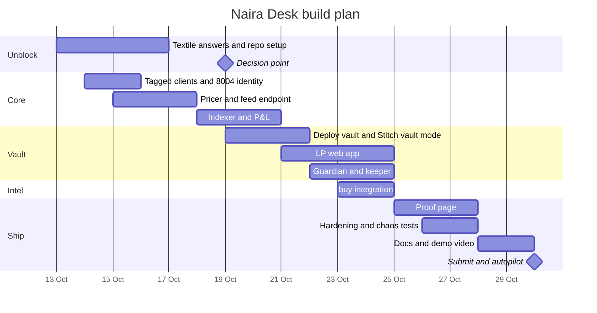

**Decision: GO on the vault path (13 Oct, six days early).** Textile confirmed a self-serve maker key, inclusion in RFQ requests, Warp co-signing, epochs and NAV handled by Stitch and Textile, and that vault fills count for the track. Because vaults are beta, move "Deploy vault and Stitch vault mode" earlier, to 15–17 Oct.

**New bottleneck: LP deposits.** The vault can't quote until LPs fund it. Start lining up depositors now so the first deposits land around 17–19 Oct. FX402 stays only as an emergency fallback.

---

## 15. Open questions (blocking, in priority order)

**Answered by Textile (CEO Tomer and CTO, 13 Oct):**
- ✅ **Maker key** is self-serve. Run Stitch, add a corridor, and the wizard connects to Textile and verifies your email.
- ✅ **Self-deployed vaults are included in RFQ requests.** UI: `app.textilecredit.com/s/vaults/deploy`. New vaults aren't listed on `/s/vaults` by default.
- ✅ **Stitch vault mode** is in the corridor's "Experimental" section. Vaults are **beta and "a bit rough"**, so deploy and test early (16–17 Oct) with small caps.
- ⚠️ **Don't let Stitch send transactions from agent key A** (for example "Approve allowances"). Vaults don't need approvals, and A's first transaction must be our tagged ERC-8004 registration.

**Follow-up answers (Textile CEO and CTO, 13 Oct):**
- ✅ **Deploy values:** copy the presets on `/s/vaults/deploy` (risk signer, fee collector, Textile fee shares, and so on). Set the operator signer to the Stitch wallet. Deploying from our own script is fine.
- ✅ **Warp co-signs fills for our vault** the same way as for the existing vaults.
- ✅ **Stitch and Textile handle epochs and NAV attestations.**
- ✅ **Fills where our vault is the maker count** as our volume and P&L for the Textile track.
- ✅ **Stitch install:** `app.textilecredit.com/stitch`.
- 💡 **Test tip:** `https://app.textilecredit.com/s/swap?sell=USDT&buy=cNGN&chainId=42220&amount=1&restricted=<vault>` forces a swap against our vault only. Do the first end-to-end test with a tiny amount from a wallet we label as ours, and exclude it from metrics.

**Still open, for Textile (ask only if needed):**
1. ❓ Would you list our vault on `/s/vaults` once it's live? That helps LP discovery.

**For the organizers:**
2. ❓ Is `celo_1944046be211` tied to a repo name? We haven't created the repo yet.
3. ❓ Are buy calls attributed by payer = registered agent wallet?

**For us to verify in code (no one to ask):**
8. ⚠️ Does Stitch support changing module or profile settings without a full restart?
9. ⚠️ Can we pay the buy gateway with a generic x402 client using key A?
10. ⚠️ Which Nigerian market source has a usable, ToS-compliant API?
11. ⚠️ Hosting without a card.

---

## 16. Out of scope for v1

- wARS/wBRL vaults (same design; add after the hackathon).
- Fiat on/off-ramp.
- MiniPay mini-app.
- Our own risk co-signer.
- Yield adapter.
- Automatic spot rebalancing to a dealer (Stitch supports it, but we have no dealer).
