# Naira Desk: Architecture

*Version 0.3, 26 Oct 2026. Hackathon: Agents on Open Rails (Celo). Tracks: **Textile FX** (main) and **Build with buy** (add-on). Attribution code: `celo_1944046be211`.*

**Legend:** ✅ verified (onchain, source code or docs) · ⚠️ assumption to confirm · ❓ open question that blocks something.

---

## 0. In one paragraph

Naira Desk is an **onchain bureau de change for the naira**, run by an autonomous agent on Celo. Like a street BDC, it does two things: it **makes** a market, quoting both sides to anyone who asks, and it **takes** a good price when another dealer offers one.

- **Making.** A community-funded Textile **Operator Vault** quotes cNGN/USD₮ at the price cNGN trades onchain. Textile's Stitch bot signs the quotes and Textile's Warp service co-signs them. The agent feeds the price and decides, from research it buys through **buy**, when to quote, when to be careful and when to stop.
- **Taking.** The **Taker**, a small contract the agent owns, buys from Textile makers whose quote is below the Uniswap price and sells into Uniswap in the same transaction. If the trade wouldn't make money, it reverts. It covers every Textile pair with a Uniswap pool: cNGN, wBRL, wARS and others.

Everything (fills, NAV per share, Taker P&L, paid calls, tags) is indexed from chain and shown on a public dashboard.

**Why both.** On Celo, cNGN flow on Textile is almost all arbitrage. The Uniswap pool values cNGN about 0.9% above the off-chain naira, Textile's makers price at the off-chain naira, so takers buy from the makers and sell to the pool. A maker that fills that flow loses, so the vault quotes at the pool price and fills rarely. The money is on the taking side, and the Taker takes it (section 1.1).

**Goals**
1. Positive, verifiable strategy P&L and real filled volume on Textile, mostly from the Taker.
2. Quoted volume and a community-funded float from the vault.
3. Runs unattended and fails safe: a Taker trade makes money or doesn't happen, and the vault stops quoting when its price can't be trusted.
4. Every transaction the desk sends is tagged, including every Taker fill. The ERC-8004 identity links the agent, vault, Taker and repo.

**Non-goals (for this hackathon):** a custom RFQ maker protocol, fiat ramps, a MiniPay listing, holding positions (every Taker trade ends in USD₮).

---

## 1. What the deep review found, and what it changed

| # | Finding | Status | Design consequence |
|---|---|---|---|
| 1 | `OperatorVaultFactory.deployVault` only checks `msg.sender == init.operatorAdmin`. Deposits have no allowlist. | ✅ factory and vault source, Blockscout-verified | Naira Desk can deploy its own vault, and community LPs can fund it directly. |
| 2 | Every vault fill needs **two EOA signatures** (strategy and risk) over the Permit2 digest, plus order-policy checks: reactor, swapper = vault, trading epoch in the nonce, lifetime cap, per-order caps, quotable inventory, close-only, preferred fillers. | ✅ `VaultPolicy.validateEnvelope` | The contract enforces safety, not the agent's code. |
| 3 | Stitch docs: the **venue supplies "Warp" co-signing**. Both existing Celo vaults use the same `riskSigner` `0x9bC2…32a3` and `riskAdmin` `0x5172…bA4`. | ✅ docs, onchain, and confirmed by the Textile team | **Risk signer = Textile Warp, not the agent.** The desk's risk logic sits before signing (pricer, risk officer). |
| 4 | Stitch already has **vault modules**: inventory balancing, dynamic spreads, spot rebalancing. It also co-signs NAV attestations. | ✅ `docs/modules.md` | No quoting maths to rebuild. |
| 5 | Stitch prices off an HTTP feed `{price, timestamp}`, where price is USD₮ per cNGN. Stale or invalid prices stop quoting. | ✅ README and ADVANCED.md | The **feed is the control surface**: price in, and a halt is a 503 response. |
| 6 | The vault pre-approves Permit2 in its constructor. | ✅ `OperatorVault` constructor | No approval transactions are needed for vault trading. |
| 7 | Onchain, a fill is `Fill(orderHash, filler = taker, swapper = maker)`. | ✅ decoded reactor logs | Vault fills have `swapper = vault`; Taker fills have `filler = Taker`. Indexing is simple. |
| 8 | Celo Textile, 13 Oct: **136 fills, 13 distinct takers, 5 makers. One maker did about 75%.** | ✅ RPC log scan | Real flow, but concentrated. |
| 9 | Uniswap V3 on Celo has 0.01% pools for cNGN, wBRL and wARS against USD₮. | ✅ factory `getPool` | The onchain price for the vault and the exit for the Taker. |
| 10 | Textile's deploy-page defaults: 5-minute epochs, 1-day redemption cooldown, 1-day valuation timeout, 2-day emergency exit, 10% of each fee to Textile, idle USD₮ lent on Aave. | ✅ deploy page and decoded `deployVault` calls | Keep the roles and timings and set custom fees, caps and minimums (section 6.2). |
| 11 | Textile Ramp (NGN bank) is BSC/Base only. | ✅ live API | No fiat. LPs deposit USD₮ or cNGN already on Celo. |

### 1.1 Market review, 24–26 Oct

| # | Finding | Status | Design consequence |
|---|---|---|---|
| 12 | The Uniswap cNGN/USD₮ pool sits near ₦1,367.6 per USD₮ while the off-chain naira (Luno, Textile makers) is ₦1,376–1,382. From 21 to 24 Oct, all 44 cNGN fills on Textile (about $4,350) were takers buying cNGN. None sold. | ✅ pool reads, Luno, reactor logs | The flow is arbitrage. A maker that fills it loses about 0.9%, so the vault prices at the pool (7.5) and fills rarely. |
| 13 | A take in two transactions, buy on Textile then sell on Uniswap, is left holding the token whenever the second one fails or the pool moves in between. | ✅ reactor and pool mechanics | One transaction per trade removes the risk of being left holding a token. |
| 14 | The reactor is UniswapX's `LimitOrderReactor`. Textile orders carry `PreferredFillerValidation`: only the taker named in the quote can fill before the order deadline. | ✅ Blockscout-verified source, decoded orders | The Taker contract must be the named taker. |
| 15 | `POST /v2/rfq/request` binds a firm quote to `taker`, proven by an EIP-712 `TakerControl` signature. Contract takers are verified through EIP-1271. The taker must already hold what it sells (`insufficient_funds`). | ✅ `api.textilecredit.com/v2/openapi.json` | The Taker answers EIP-1271 with the agent key, using Textile's `eip191` text, and holds a USD₮ float. No flash fills: a trade is at most the float. |
| 16 | `GET /v2/rfq/levels` returns every pair's ladder (depth and indicative prices, fee included) in one call, cached about 2s. Nothing is reserved. | ✅ OpenAPI and a live call | The agent scans every pair every few seconds for free and only asks for a firm quote when there's a gap. |
| 17 | Snapshot, 26 Oct 11:00 UTC: wBRL 1.0% under Uniswap with $47k of maker depth, but the pool only takes about $420 before the gap closes. cNGN and wARS 0.2%, with $2–3 of maker depth. Gas is about 200 gwei, so a Taker trade costs under a cent. | ✅ live levels and QuoterV2 | Gaps are real but small and short-lived. Size each trade to the pool's depth, not the maker's. |

---

## 2. System context

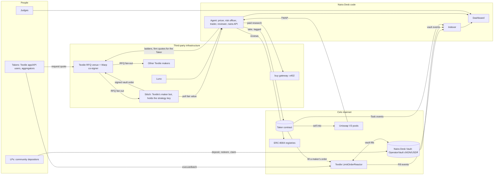

---

## 3. Actors, agents and keys

### 3.1 The agents (roles inside one service, plus Stitch)

| Agent | Runs where | Decides | Can never |
|---|---|---|---|
| **Pricer** | the agent | cNGN's price where it trades onchain (Uniswap TWAP), checked against the off-chain naira (Luno, Textile). | Sign anything. Move funds. |
| **Risk officer** | the agent | Mode (normal, caution, halted) from news and street-rate posts it buys through buy, price jumps and peg drift. | Spend past the buy budget. |
| **Executor** | **Stitch** (Textile code, its own strategy key S) | Vault quote size and side within the vault caps, inventory balancing, spread. | Sign without a fresh feed. Fill without Warp's co-sign. |
| **Trader** | the agent | Which Textile quote the Taker takes, how big, and the minimum profit. | Hold a position: every take ends in USD₮ or reverts. Take from the desk's own vault. |
| **Reviewer** | the agent | Once a day, an ERC-8004 rating for each service it paid. | Rate itself. |

### 3.2 Keys and roles

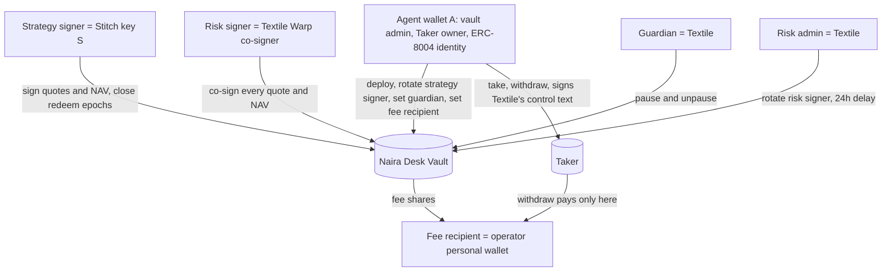

Vault rules: `strategySigner ≠ riskSigner` and `operatorAdmin ≠ riskAdmin` ✅.

**Why Stitch has its own key:** the vault lets the strategy signer close redemption epochs, so Stitch sends its own transactions, and those can't carry the tag. Keeping them off A keeps every transaction from the agent wallet tagged.

**Why A can trade but can't take the money:** A is a hot key, so the Taker is built so that even A can't move its funds anywhere but the operator's wallet. `take` can't lower its USD₮, `withdraw` only pays the operator's wallet, and `isValidSignature` only vouches for Textile's taker-control text for this contract. That last part matters because Celo's USD₮ also asks a contract holder's `isValidSignature` before honouring a `permit` or `transferWithAuthorization`, so a contract that vouched for anything A signed could be emptied with a signature.

**Why fees and profits go to the operator's wallet:** A is a hot key on a server. Vault fee shares are paid straight to the operator's wallet, and the Taker can only pay out there.

---

## 4. Components

| Component | Stack | Responsibility |
|---|---|---|
| `apps/agent` | Node 24, TypeScript, viem, Hono | Pricer, risk officer, trader, reviewer. Serves `/feed/cngn-usdt` to Stitch, the paid `/v1/naira` API and the free `/v1/tape`. |
| `apps/indexer` | viem `getLogs`, `node:sqlite` | Vault events, reactor fills where the vault is the maker, Taker trades. Serves `/api/summary`, `/api/fills`, `/api/nav`, `/api/taker`. |
| `apps/web` | Next.js, shadcn/ui, Recharts | The dashboard: rates, vault, Taker, decisions, reviews and sales, each linked to its transaction. |
| `packages/contracts` | Solidity, Foundry | `Taker.sol` and its tests, including a mainnet-fork replay of a real Textile order. |
| `packages/chain` | viem | The only place wallet clients are created, always tagged. ABIs and addresses. |
| `packages/pricing` | TypeScript | Uniswap TWAP, Textile preview and Luno adapters, and the fair-value check. |
| `packages/intel` | TypeScript, `@celo/buy-core` | Paid calls through buy, capped at $0.01 a call and $0.20 a day. |
| `packages/shared` | TypeScript | Constants, data files, types. |

---

## 5. Deployment topology

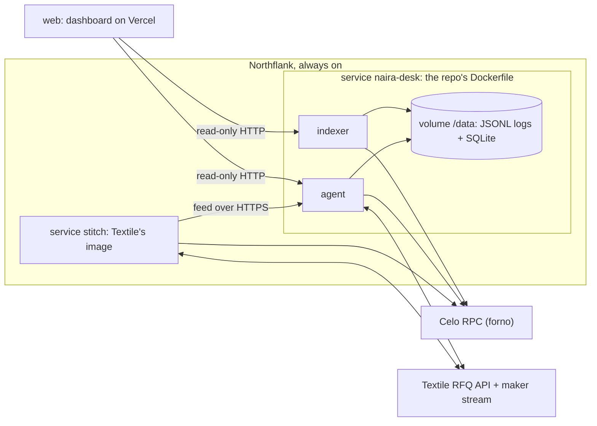

Since 30 Oct nothing runs on the operator's laptop. Two always-on services on Northflank's free plan: `naira-desk` runs the agent and indexer from the repo's `Dockerfile` with a volume for their data, and `stitch` runs Textile's published Stitch image with the vault bot's config. Stitch reads the agent's feed at its public HTTPS address, since it refuses plain HTTP off localhost. The dashboard is on Vercel at [naira-desk.vercel.app](https://naira-desk.vercel.app), with its project root at `apps/web`. Merges to `main` redeploy the desk and the dashboard. Keys are runtime secrets: the agent's key is written once to the volume, and Stitch's entrypoint writes its signer key and maker credential to owner-only files and drops them from the environment. The Taker only earns while the agent runs, and the biggest gap so far opened around midnight in Lagos, which is why none of this depends on a laptop.

---

## 6. Onchain layer

### 6.1 Addresses (Celo 42220)

| Contract | Address | Status |
|---|---|---|
| Agent wallet A (ERC-8004 #9908) | `0xE4D88C9A86bd42D4f5D05a234E6D56f71bB58582` | ✅ owns the Taker, administers the vault |
| Naira Desk Vault | `0xD7137d85607BE18628CE00B1020895cEBceEAD6C` | ✅ deployed 14 Oct |
| Taker | `0xcf024F46d1756498f3ffD04F1Da4793eE1eFdA57` | ✅ deployed 26 Oct, owner A, Sourcify exact match |
| OperatorVaultFactory | `0x88104decA449C797632AfdcA77A3140b24cD844A` | ✅ |
| LimitOrderReactor | `0xa9AA0a64769cBed4d3B1Ceb4Df01CdE915C235b3` | ✅ |
| PreferredFillerValidation | `0x10B9EbA3a175Df418a35CB8329a527691EE258C5` | ✅ |
| Permit2 | `0x000000000022D473030F116dDEE9F6B43aC78BA3` | ✅ |
| Fee controller (1 bp) | `0x7b005466F905DD882A959888154587fA76cd3Ea7` | ✅ |
| Uniswap V3 factory | `0xAfE208a311B21f13EF87E33A90049fC17A7acDEc` | ✅ |
| Uniswap QuoterV2 | `0x82825d0554fA07f7FC52Ab63c961F330fdEFa8E8` | ✅ |
| Uniswap SwapRouter02 | `0x5615CDAb10dc425a742d643d949a7F474C01abc4` | ✅ |
| Uniswap cNGN/USD₮ 0.01% | `0x6519d56Eb0A69FC0338657784c783B169b8f7d32` | ✅ |
| Uniswap wBRL/USD₮ 0.01% | `0x01c3cf91cdf7B34181C7eC8566c0236951FEA40F` | ✅ |
| Uniswap wARS/USD₮ 0.01% | `0x5D8ef8B839be522b9E3d60a51EDB5837CD0b2391` | ✅ |
| USD₮ (6 decimals) | `0x48065fbBE25f71C9282ddf5e1cD6D6A887483D5e` | ✅ |
| cNGN (6 decimals) | `0xF6829D7393dAe24509eb1E52eE8e572e2E271a4f` | ✅ |
| wBRL (18 decimals) | `0xD76f5Faf6888e24D9F04Bf92a0c8B921FE4390e0` | ✅ |
| wARS (18 decimals) | `0x0DC4F92879B7670e5f4e4e6e3c801D229129D90D` | ✅ |
| ERC-8004 Identity / Reputation | `0x8004A169…a432` / `0x8004BAa1…9b63` | ✅ |
| Textile Warp risk signer | `0x9bC2f7601f22fFA95bD9dDbF9Bc11d06f54B32a3` | ✅ |
| Textile risk admin | `0x51727A09b55d56BF8f3CBe61f460327330aECbA4` | ✅ |
| Textile guardian | `0x15c73f757f9db89CdeB366676C294b8A6aa4B76d` | ✅ |

### 6.2 Vault parameters (`VaultInit`)

`pnpm vault:deploy` kept Textile's presets for roles and timings and set custom fees, caps and minimums. The values live in `packages/chain/src/vault.ts`. Everything except the roles, fee recipient and liquid floor is fixed.

| Field | Value | Why |
|---|---|---|
| name / symbol | `Naira Desk USDT/cNGN` / `tvUSDT-cNGN` | |
| settlementAsset / corridorAsset | USD₮ / cNGN | |
| operatorAdmin | agent wallet **A** | The registered agent owns its vault, and the deploy is tagged |
| strategySigner | Stitch key **S** | Swapped in from A with `setStrategySigner` |
| feeRecipient | operator personal wallet | Fee shares stay off the hot key |
| riskSigner / riskAdmin / guardian | Textile Warp / Textile / Textile | ✅ deploy-page preset |
| maxOrderInputSettlement / Corridor | 1,000 USD₮ / ₦1,400,000 | Caps the damage from one bad fill |
| maxOrderLifetime | 7200 s | Same as Textile's own vaults |
| deposit / redemption epoch | 300 s / 300 s | ✅ preset |
| redemptionCloseCooldown | 86,400 s | ✅ preset |
| valuationTimeout / emergencyExitTimeout | 86,400 / 172,800 s | ✅ preset |
| managementFeeWad / performanceFeeWad | 0 / 0.20e18 | No fee on deposits. The operator earns 20% of profit above the high-water mark, and Textile takes a tenth of that |
| minDepositAssets / minDepositCorridor | 5 USD₮ / ₦7,000 | Small community tickets, in either asset |
| minRedeemShares | 1 share | Smaller amounts allowed when redeeming a whole balance ✅ |
| enableYield / minLiquidSettlement | true / 1,000 USD₮ | Idle USD₮ above the floor earns Aave yield |
| perfFloorEnabled | true | High-water mark |

### 6.3 Taker contract

One small, immutable contract, owned by A.

| Function | Who | What |
|---|---|---|
| `take(swap, token, fee, minProfit)` | A only | Approves the reactor for the length of the call, runs Textile's swap calldata (the reactor sends the maker's `token` to the Taker and takes USD₮ to the maker), sells everything it received on the Uniswap `token`/USD₮ pool at fee tier `fee`, and reverts unless its USD₮ balance grew by at least `minProfit`. Emits `Took(token, amount, spent, received)`. |
| `isValidSignature(hash, signature)` | anyone (view) | EIP-1271 for Textile's taker check only. `signature` is the nonce and issuedAt sent to Textile, then A's `personal_sign` of Textile's `eip191` taker-control text. The Taker rebuilds that text for its own address and chain and vouches only when `hash` is that text's hash and A signed it. |
| `takerControl(nonce, issuedAt)` | anyone (view) | The text above, so the agent and anyone checking can read exactly what A signs. |
| `withdraw(token, amount)` | A or the beneficiary | Pays the beneficiary, the operator's wallet. `address(0)` sends native CELO. |
| `receive()` | anyone | Accepts native CELO. The reactor sends any CELO it holds to the filler at the end of a fill, so refusing it would let anyone block every take with 1 wei. |

The owner, beneficiary, reactor, USD₮ and router are immutable. No upgrades, no Permit2 allowance, no other entry points. Quotes whose `spender` isn't the reactor (yield-vault orders routed through Textile's executor) are skipped.

---

## 7. Core flows

### 7.1 Bootstrap (done, 14–17 Oct)

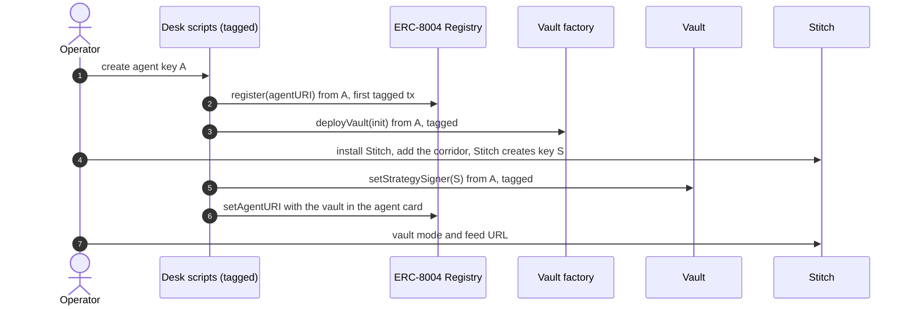

### 7.2 Making: RFQ quote to vault fill

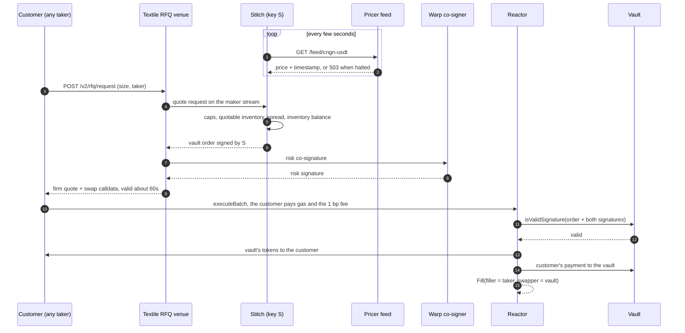

### 7.3 Taking: gap to profit

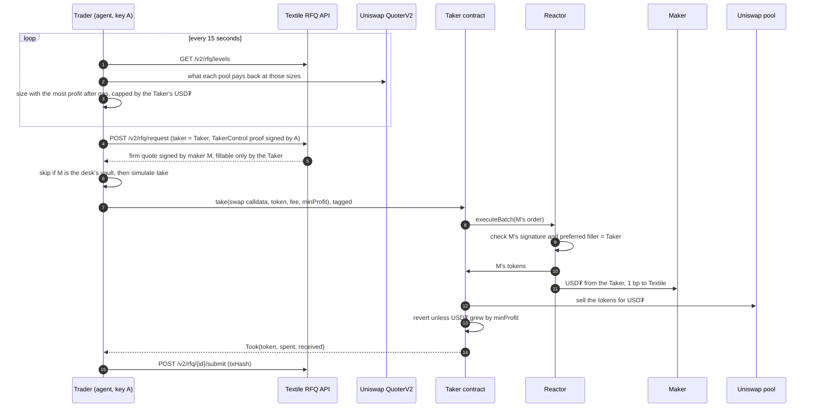

A firm quote holds the maker's liquidity until its deadline, even if cancelled, so the trader only asks when it means to trade. A lost race (the pool moved before the take landed) reverts and costs only gas.

**Worked example** (26 Oct, a real cNGN order): the maker sells ₦6,154.19 for 4.4556 USD₮ (₦1,381.2). The pool pays 4.4994 USD₮ for it after its 0.01% fee. Less Textile's 0.01% fee and about $0.006 of gas, about **$0.037** is left.

### 7.4 LP deposit and redemption

LPs deposit USD₮ (5 minimum) or cNGN (₦7,000 minimum) with `requestDeposit` from any wallet. Stitch and Warp process each 5-minute epoch at NAV and LPs `claim` their shares. Redemptions are in kind: USD₮ and cNGN pro rata, after the epoch settles. If the signers vanish, anyone can force an in-kind exit after 48 hours ✅. The operator can't withdraw LP funds; the contract enforces it.

### 7.5 Pricing pipeline (Pricer)

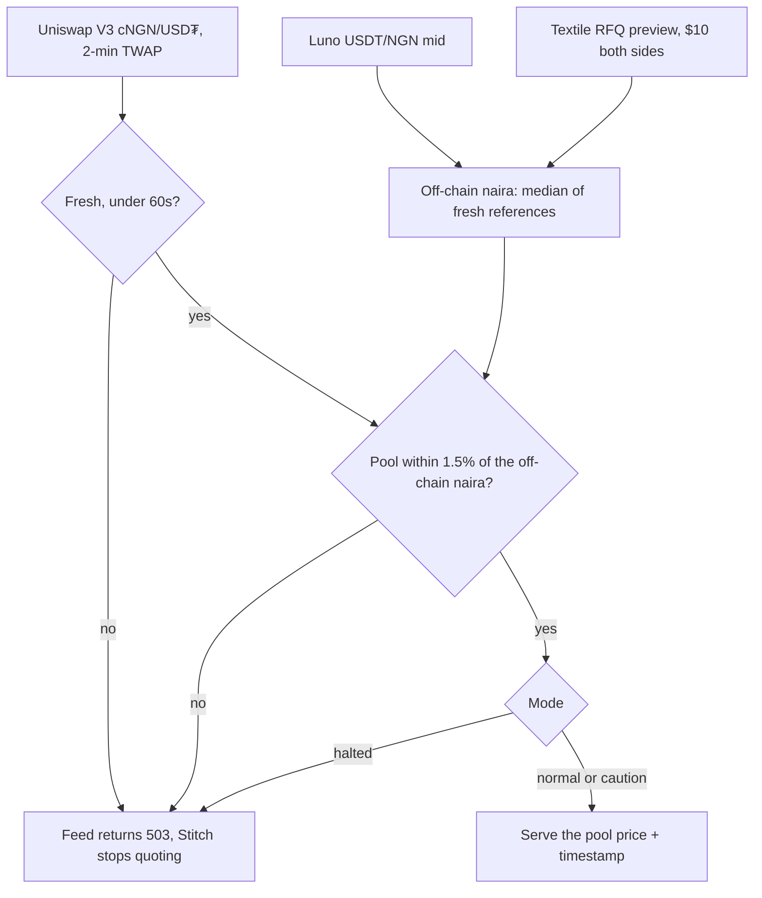

**Why the pool:** the vault trades onchain cNGN, and quoting at the pool is the only price nobody can buy from the vault and sell to the pool at a profit. Off-chain rates don't set the price, they check cNGN still tracks the naira. The dashboard shows the gap between the two as cNGN's premium.

### 7.6 Risk modes (Risk officer)

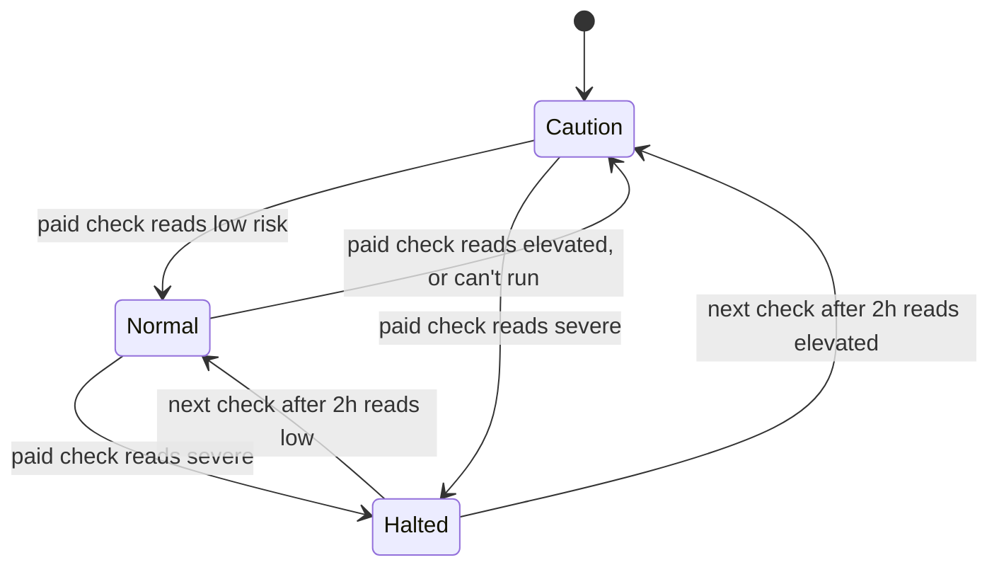

A check runs every 6 hours in normal mode, every 2 hours otherwise, and straight away when the pool moves 0.5% in 10 minutes or cNGN leaves the peg band for 2 minutes. Each check buys X posts on the naira and street rates and an AI read of both through buy ($0.02), and compares the onchain rate with the official and parallel rates people are quoting. Halted means the feed returns 503. The Taker isn't gated by the mode: its trades lock in profit inside one transaction.

### 7.7 Paid research with buy

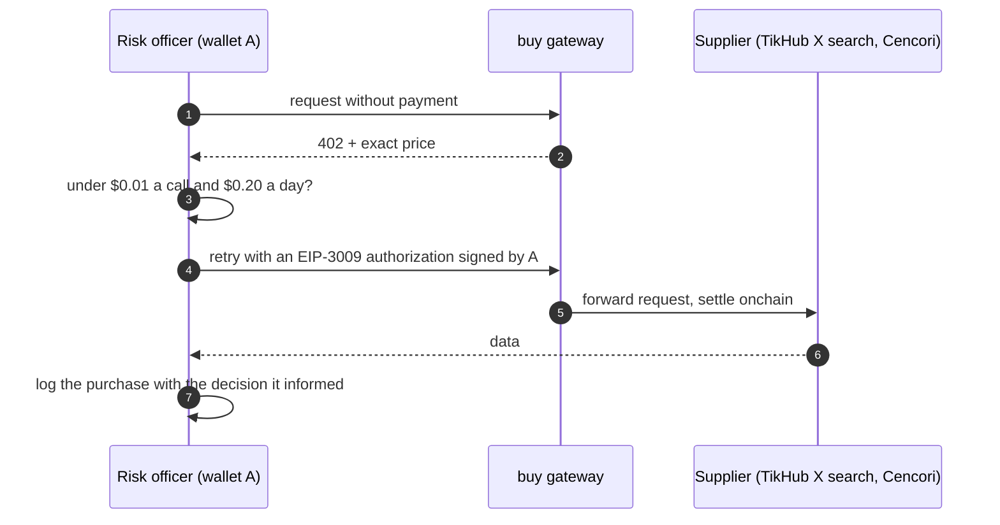

Once a day the reviewer rates each supplier on its ERC-8004 identity, scored on how many paid calls delivered. The agent also sells what it learns: `GET /v1/naira` costs $0.005 over x402 and the agent settles each payment itself.

### 7.8 Metrics and proof

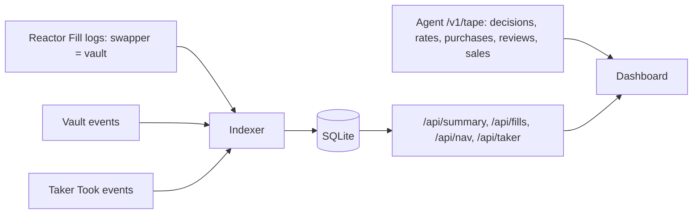

---

## 8. User journeys

**LP.** Reads the vault card on the dashboard, deposits 5 USD₮ or ₦7,000 cNGN, claims shares after the epoch, follows the share price, and redeems for USD₮ plus cNGN. Before depositing they see: you can lose money if the naira moves against the vault; exits are in kind; the operator can't withdraw your funds.

**Taker.** Nothing new: they use the Textile app or API, and the desk's vault is one of the makers that may quote.

**Operator.** Merges releases to `main`, which redeploys the desk and the dashboard; funds the Taker's float and the agent's gas; and withdraws profits from their own wallet. Locally, `pnpm agent`, `pnpm indexer` and `pnpm web` run the same stack for development, never alongside the hosted agent, since both would trade with the same key.

**Judge.** Opens the dashboard: vault value and share price, volume filled, Taker trades and P&L, paid research, reviews and API sales, each linked to Celoscan. The agent's ERC-8004 card links the vault, Taker and repo.

---

## 9. Attribution and ERC-8004 wiring

| Transaction | Sent by | Tagged? | How |
|---|---|---|---|
| `register`, `setAgentURI` (ERC-8004) | A | ✅ | `packages/chain` tagged client |
| `deployVault`, `setStrategySigner` | A | ✅ | same |
| Taker deploy, `take`, `withdraw` | A | ✅ | same. Every Taker fill happens inside a tagged transaction from A |
| `giveFeedback` (supplier reviews) | A | ✅ | same |
| Naira API settlements (`transferWithAuthorization`) | A | ✅ | same |
| Vault fills (`executeBatch`) | takers | ❌ sent by takers | Counted through `Fill.swapper = vault`. ✅ Textile confirmed these count as the desk's volume and P&L |
| Epoch closes, NAV settlement | Stitch (S), Warp | ❌ sent by takers | S isn't A, so A stays fully tagged |
| LP deposits | LP wallets | ❌ unless their wallet adds the suffix | |
| buy settlements | buy's facilitator | ❌ | Payer is A |

The agent card (onchain as a data URI, from `agent-card.json`) links the repo, the vault and the Taker.

---

## 10. Data model

**Indexer (SQLite):** `cursor` (last block), `vault_events` (block, log index, tx, time, name, args), `fills` (vault fills: block, log index, tx, time, order hash, filler, sender, side, USD₮, cNGN), and `taker_trades` (block, log index, tx, time, token, amount bought, USD₮ spent and received, gas paid), with its own `taker_cursor` since the Taker was deployed after the vault.

**Agent (JSONL in `~/.naira-desk`):** `decisions`, `purchases`, `rates`, `reviews`, `sales`, and `trades`: every gap the trader sees (at most every 5 minutes per market, sized as if the Taker held $100), every take, and every miss with its reason.

**P&L:**
- Vault: change in NAV per share, after fees.
- Taker: sum of `received − spent` over `Took` events, minus gas.
- Strategy: vault + Taker, minus buy spend.
- The desk's own wallets (agent, operator, Stitch) never count as independent volume or LPs.

---

## 11. Exposed APIs

| Endpoint | Consumer | Response |
|---|---|---|
| `GET /feed/cngn-usdt` (port 8787) | Stitch | `{ "price": 0.000731, "timestamp": 1760000000 }`, or **503** when halted |
| `GET /v1/naira` (port 8788) | other agents, $0.005 over x402 | onchain rate, official and parallel rates, the current risk call and its receipts |
| `GET /v1/tape` (port 8788) | dashboard | decisions, rates, purchases, reviews, sales |
| `GET /api/summary`, `/api/fills`, `/api/nav`, `/api/taker` (port 8789) | dashboard | vault and Taker metrics from the indexer |

---

## 12. Security and threat model

| Threat | Impact | Mitigation |
|---|---|---|
| Stitch key S leaks | Attacker can sign vault orders | Still needs Warp's co-sign and the vault caps. A calls `setStrategySigner`, which invalidates every order ✅ |
| Agent key A leaks | Owner actions on the vault; trading with the Taker | Can't move LP assets ✅. Can't move the Taker's funds either: they only go to the operator's wallet, and the Taker won't vouch for a USD₮ permit or transfer authorization. Move ownership to a Safe once real money is involved. |
| Bug in the Taker | Float lost | Small and immutable, owner-only entry points. Fork tests replay real cNGN and wBRL fills and cover lost races, expired and used quotes, wrong tokens and pools, short balances and signature replay. Float stays small. |
| A signature moving the Taker's USD₮ | Celo's USD₮ honours `permit` and `transferWithAuthorization` for a contract holder that vouches for them | The Taker only vouches for Textile's taker-control text. A fork test shows a contract that vouches for anything is emptied, and the Taker isn't, even with A's own signature. |
| The pool moves before the take lands | The take reverts | Costs gas only, under a cent |
| Someone sends the reactor 1 wei of CELO | Every take reverts on the refund | The Taker accepts native CELO |
| Bad or stale price source | Mispriced vault quotes | Pool TWAP, peg check against Luno and Textile, Stitch rejects stale feeds ✅ |
| Naira shock or arbitrage wave | LP losses | Quoting at the pool, paid news checks, per-order caps |
| Machine down | No quotes, no takes | Fails safe. LPs can still redeem; forced in-kind exit after 48h ✅ |
| Self-dealing optics | Disqualification risk | The Taker never fills the desk's vault. The desk's wallets are published and excluded from independent metrics. |
| Regulatory (pooling public money) | Legal risk | Small caps, clear risk card, no promised yield |

**Key handling:** key A is a file with `chmod 600`, never in the repo or chat. Stitch generates and keeps key S. The operator wallet stays on a phone and only receives fees and profits.

---

## 13. Repo structure

```
naira-desk/
├─ apps/
│  ├─ agent/      pricer, risk modes, trader, reviewer, feed, naira API, tape
│  ├─ indexer/    vault events, vault fills, Taker trades into SQLite
│  └─ web/        dashboard (Next.js)
├─ packages/
│  ├─ chain/      tagged clients, addresses, ABIs
│  ├─ contracts/  Taker.sol and its fork tests (Foundry)
│  ├─ intel/      paid calls through buy
│  ├─ pricing/    Uniswap, Textile and Luno adapters, fair value
│  └─ shared/     constants, files, types
├─ scripts/       register, deploy and status scripts
└─ docs/          ARCHITECTURE.md
```

---

## 14. Build plan

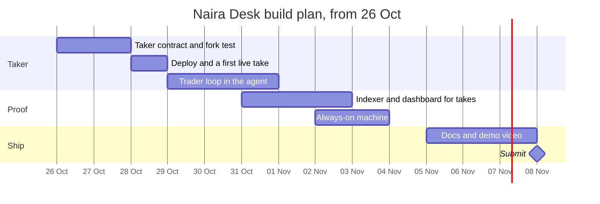

**Status:** the vault has traded on Textile since 17 Oct, the agent has run paid risk checks, reviews and the naira API since 16 Oct, and the indexer and dashboard read everything from chain. The Taker was deployed on 26 Oct and made its first four trades that day. Since 30 Oct the desk, Stitch and the dashboard run hosted, and Stitch quotes the vault off the agent's own feed.

---

## 15. Confirmations and open questions

**Confirmed with the Textile team:**
- ✅ The maker key is self-serve through the Stitch wizard.
- ✅ Self-deployed vaults are included in RFQ requests.
- ✅ Warp co-signs fills for the desk's vault, and Stitch and Textile handle epochs and NAV attestations.
- ✅ Fills where the desk's vault is the maker count as the desk's volume and P&L for the Textile track.

**From Textile's published API (26 Oct):**
- ✅ Contract takers are supported through EIP-1271.
- ✅ The taker must hold what it sells when it asks for a firm quote.
- ✅ `/v2/rfq/levels` is open to everyone.

**Open:**
1. ⚠️ Rate limits on `/v2/rfq/request` (it can answer 429).
2. ⚠️ How fast the other takers react: the Taker wins only the gaps it reaches first.
3. ⚠️ Hosting.

---

## 16. Out of scope

- Buying on Uniswap and selling on Textile. Textile checks the taker holds the token it sells, so the Taker would need a float in every token.
- Flash fills with no float, for the same reason.
- Fiat on/off-ramp, MiniPay mini-app, a custom risk co-signer.
- wARS and wBRL vaults.
